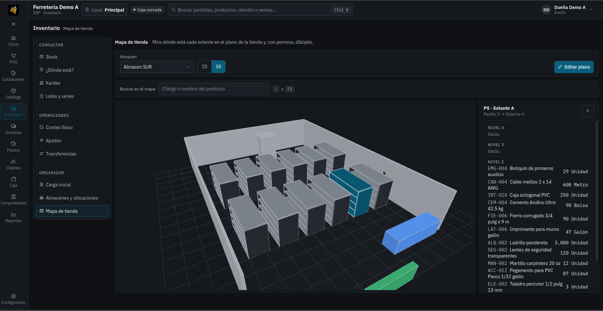
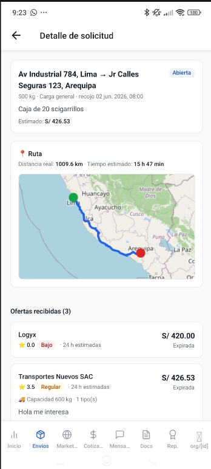
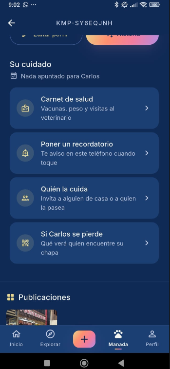
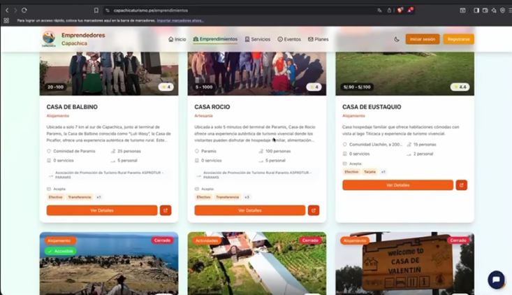
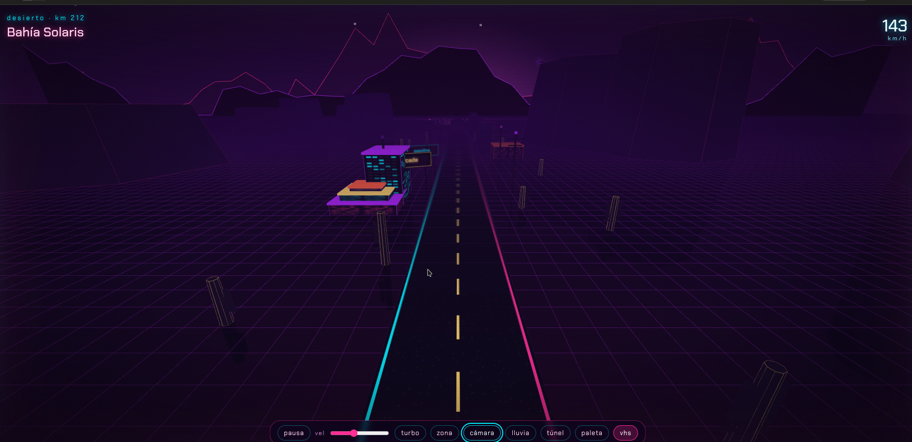
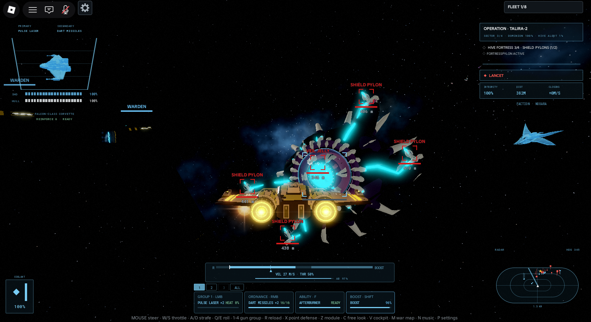

<!-- Va en un repo PÚBLICO llamado exactamente TheReeds, en la raíz, como README.md -->
<!-- Imágenes: crea una carpeta /assets en ese repo y sube ahí tus capturas (ferreos.png, logyx.png, etc.) -->
<!-- Busca "TU-REPO" y "TU-USUARIO" y reemplaza con los enlaces reales -->

---

## 👋 Sobre mí

- 🎓 Estudiante de Ingeniería de Sistemas en la **UPeU**
- 🚀 Fundador en proyectos de software en etapa temprana (**LOGYX**, **FerreOS**)
- 🛠️ Me gusta construir productos completos: backend, web, móvil, y también videojuegos
- 🤖 Interés en robótica, IoT y visión por computador
- 📫 Contacto: _george159357852@gmail.com_ · [LinkedIn](https://www.linkedin.com/in/jorge-luis-gutierrez-miranda-502565363/)

---

## 🧰 Stack

---

## ⭐ Proyectos destacados

### 🏢 Productos y startups

<table>
  <tr>
    <td width="50%" valign="top">
      
      <h3>🔩 FerreOS</h3>
      
SaaS multiempresa de marca blanca para ferreterías: POS, inventario, ubicación de productos en tienda, integración con WhatsApp y un copiloto de IA para vendedores con acceso a la base de datos. <i>(En desarrollo)</i>

      

        
        
        
        
      

      <a href="https://github.com/TheReeds/TU-REPO">Código</a> · <a href="https://TU-DEMO.com">Demo</a>
    </td>
    <td width="50%" valign="top">
      
      <h3>🚚 LOGYX</h3>
      
Plataforma logística colaborativa B2B para pymes en el corredor Lima–Sierra Sur. Monorepo con web y app móvil. Proyecto de egreso (EPE) desarrollado con mis cofundadores.

      

        
        
        
        
      

      <a href="https://github.com/TheReeds/TU-REPO">Código</a> · <a href="https://TU-DEMO.com">Demo</a>
    </td>
  </tr>
  <tr>
    <td width="50%" valign="top">
      
      <h3>🐾 Kumpan</h3>
      
App de mascotas con identidad visual lo-fi de atardecer, pensada para dueños de perros y gatos.

      

        
      

      <a href="https://github.com/TheReeds/TU-REPO">Código</a> · <a href="https://TU-DEMO.com">Demo</a>
    </td>
    <td width="50%" valign="top">
      
      <h3>📱 App CAPACHICA</h3>
      
App móvil publicada en Play Store para la Municipalidad Distrital de Capachica, como proyecto de vinculación con el medio de la UPeU.

      

        
      

      <a href="https://play.google.com/store/apps/details?id=TU-ID">Play Store</a>
    </td>
  </tr>
</table>

### 🎮 Videojuegos

<table>
  <tr>
    <td width="33%" valign="top">
      
      <h3>🏎️ Neon Mile — GP 86</h3>
      
Juego de carreras 3D estilo retrowave en un único archivo HTML.

      

      <a href="https://github.com/TheReeds/TU-REPO">Código</a> · <a href="https://TU-DEMO.com">Jugar</a>
    </td>
    <td width="33%" valign="top">
      
      <h3>🚀 Nexus Dominion</h3>
      
Juego cooperativo de naves en Roblox contra los Noxara, con modelado 3D propio en Blender.

      

        
        
      

      <a href="https://github.com/TheReeds/TU-REPO">Código</a>
    </td>
    <td width="33%" valign="top">
      
      <h3>📖 Voz en el Desierto</h3>
      
Juego sobre el don profético con episodios bíblicos, luz progresiva y decisiones de discernimiento. Nivel 1: Samuel.

      

      <a href="https://github.com/TheReeds/TU-REPO">Código</a> · <a href="https://TU-DEMO.com">Jugar</a>
    </td>
  </tr>
</table>

### 🔬 Investigación y sistemas inteligentes

<table>
  <tr>
    <td width="50%" valign="top">
      
      <h3>🤖 Navegación autónoma CNN + EKF</h3>
      
Investigación sobre una arquitectura híbrida CNN + filtro de Kalman extendido para navegación de robots móviles en hardware de bajo costo (Jetson Nano + Transbot). MobileNetV2 con TensorRT FP16 a 13.27 ms, 10.1× más rápido que CPU.

      

        
        
        
      

      <a href="https://github.com/TheReeds/TU-REPO">Código</a> · <a href="https://TU-PAPER.pdf">Paper</a>
    </td>
    <td width="50%" valign="top">
      
      <h3>🌊 Dinámica de sistemas: Lago Titicaca</h3>
      
Modelo de Forrester de la contaminación del agua en la bahía interior del lago: 8 stocks, 3 tipos de retardo y 4 escenarios, validado con dos motores (SciPy RK4 y BPTK-Py).

      

        
        
      

      <a href="https://github.com/TheReeds/TU-REPO">Código</a>
    </td>
  </tr>
</table>

### 👨‍💼 Experiencia profesional

- **ADRA Perú** (nov 2025 – may 2026, 672 h): módulo de asistencia con reconocimiento facial. Diseñé la base de datos en PostgreSQL y la app móvil en Flutter con Clean Architecture, integrada por OpenVPN con un backend Quarkus y una API de reconocimiento facial en Python.

---

## 📊 Estadísticas

---

  

